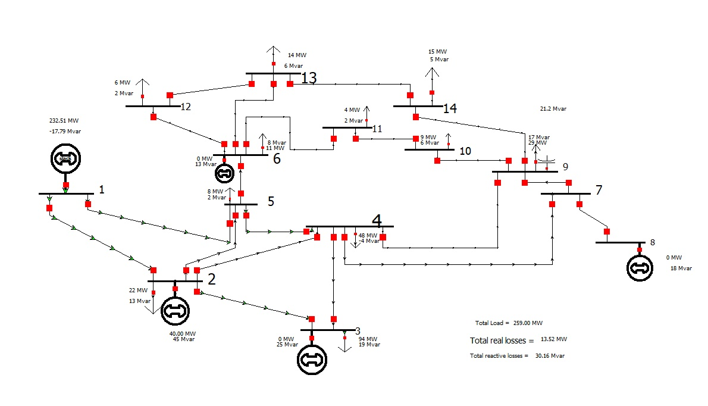

  

<h1 align="center">IEEE 14-Bus Power System Analysis</h1>

  Load-Flow Studies and Short-Circuit Analysis
   
  Using PowerWorld Simulator 21

# Overview 

This project focuses on the modelling and analysis of the IEEE 14-bus test power system using PowerWorld Simulator 21.

The primary objective is to investigate the steady-state operating characteristics of a transmission network through load-flow analysis with a subsequent into short circuit studies.  
The network is reconstructed using reference bus and branch data, incorporating generators,loads,transmission lines,transformers and shunt compensation.The resulting model is used to investigate bus voltage profiles, generator operating conditions, transmission-line power flows and system losses.

Beyond obtaining simulation results, this project emphasizes understanding the underlying power-system principles, validating model behaviour and interpreting results from an engineering perspective.

# Project Objectives
* Develop an IEEE 14-bus network model using PowerWorld Simulator.
* Undertstand and implement bus classifications:Slack,PV and PQ.
* Model synchronous generators,loads, transmission lines, transformers and shunt compensation.
* Perform Newton-Rhapson load-flow analysis.
* Evaluate bus voltage magnitudes and phase angles.
* Investigate real and reactive power flows and system losses.
* Asses generator reactive power contribution and voltage regulation.
* Extend the model to short-circuit analysis and ivestigate fault-current behaviour.

## System Specifications

| Parameter | Value |
|---|---:|
| Test System | IEEE 14-Bus |
| Number of Buses | 14 |
| Number of Branches | 20 |
| System Base Power | 100 MVA |
| Simulation Software | PowerWorld Simulator 21 |
| Analysis | Load Flow and Short-Circuit |

# Methodology
1. Network modeling.
The model incorporates:
* Bus voltage specifications and classifications.
* Generator real-power schedules and voltage setpoints.
* real and reactive load demands.
* Transmission lines series resistance and reactance.
* Line-charging susceptance.
* Tranformer impedance and off-nominal tap ratios.
* Shunt Compensations.

2. Load-Flow analysis.  
The analysis is perfomed to determine the steady-state conditions of the network. 
The analysis investigates:  
* Bus voltage magnitudes and phase angles.
* Generator Real and Reactive power outputs.
* Real and Reactive power transfers through network branches.
* Transmission losses.
* Transformer loading and voltage regulation.  

3. Model Validation
* Power Flow convergence checks.
* Real power generation and demand balance.
* Comparison of calculated bus voltages against reference data.
* Generator reactive-power limit checks.
* Bramch-flow and equipment loading assesment.  

4. Short-Circuit analysis.  
The study will investigate:  
* Three-phase short-circuit faults.
* Selected unsymmetrical faults, including line-to-ground and line-to-line faults.
* Fault current magnitude at selected buses.
* The influence of network impedance on fault levels.
* Implications for protectio-system design and equipment ratings.
 

#References
1. University of Washington, Electrical Engineering, Power Systems Test Case Archive.

2. PowerWorld Corporation, PowerWorld Simulator.

3. PowerWorld Corporation, Simulator documentation and educational resources. 

## Project Status

| Activity | Status |
|---|---:|
| IEEE 14-bus data preparation | Completed |
| Network reconstruction | Completed |
| Intial Load Flow Simulation | Completed |
| Generator Output Investigation | In-progress |
| Bus Voltage Validation | Pending |
| Branch Loading assessment | Pending |
| Power-loss Validation | Pending |
| Short-cicruit model preparation | Pending |
| Fault Simulations | Pending |
| Final Technical Report | In-progress |